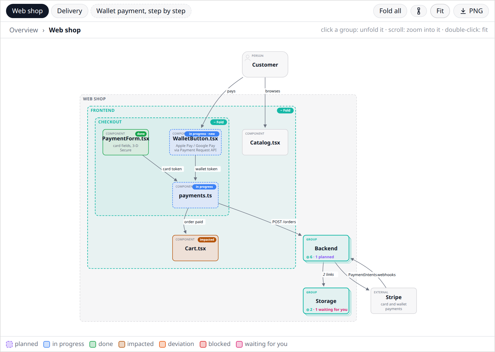

# dsh-diagram

A live architecture diagram for every [DeepSeek Harness](https://www.npmjs.com/package/@deepseek-ai/dsh) (DSH) conversation.

The agent keeps a small [LikeC4](https://likec4.dev) model of what the conversation is about. The **Diagram** tab in the right sidebar draws it as you talk. The diagram answers two questions at a glance:

- **How is it built?** The architecture, as nested groups you zoom into one level at a time.
- **What will the agent touch?** The same elements, tagged `planned`, `doing`, `done`, `blocked`… as the work goes on.



It is not a log. There are no task boxes and no history in the drawing. Reasons, numbers, commits and test results go into metadata, which you see when you click a box.

## Features

- **Schemas.** Each top-level group is a schema and gets a tab at the top of the Diagram tab; the current one is underlined. Unrelated subjects go in separate schemas. The tab row stays on one line and scrolls sideways when the sidebar is narrow (a vertical wheel scrolls it too).
- **Compact toolbar.** The tools (versions, Explorer, Fold all, layout direction, Fit, Export, `?` help) sit after the tabs, on the same row when there is room and on a second row otherwise. Below 560 px, or when their labels would not fit on one row, they show icons only, with the full name as tooltip and accessible name. Toggles that open something (Explorer, Changes, help, legend) look pressed while open; **Fold all** is always there, disabled while nothing is unfolded, so the toolbar never shifts; “Laying out…” shows over the corner of the canvas.
- **Flows.** Dynamic views follow the schema tabs after a separator, marked `▶`. A flow shows its title in the breadcrumb row with **× Leave flow**, which returns to the view you were in. A flow is laid out left to right when the canvas is wide (more than 1.3 times as wide as it is tall) and top to bottom otherwise; the layout direction button overrides this for flows, and that choice is remembered separately from the schemas' direction.
- **Help and legend.** The `?` button opens a cheat sheet of mouse gestures and keyboard shortcuts (Escape or a click outside closes it). The legend at the bottom folds into a **Legend** toggle; it starts open when the tab is at least 600 px wide, and your choice is remembered.
- **Semantic zoom.** The whole diagram is one canvas. Scroll over a collapsed group and it grows, slides to the centre and turns into its own view, while the rest fades out. Scroll back out to return to the overview. The breadcrumb and the schema tabs fly you there with an animation. **Fit** (`f`, or a double-click on empty space) shows the whole current view, its frame and the neighbours around it, without leaving it: a wheel notch either way right after a fit stays in the view. Opening a panel or resizing the sidebar keeps the picture: a view shown at its fit keeps fitting, any other camera keeps its scale and its centre point.
- **Click, chip, double-click.** A single click on a box, a frame or a link opens its details at once. A double-click on a collapsed group, or one click on the `⊕ N` chip in its footer, **unfolds it in place**: boxes slide from the old layout to the new one. A double-click on the empty space of an unfolded group folds it back, as do its `⊖ Fold` chip, **⊖ Fold** in its details, the keyboard and **Fold all**. A double-click on any other empty space fits. To enter a group's own view, scroll over it, use **Zoom in** in its details or press Shift+Enter: an unfolded generated group keeps its box positions and link routes, showing only its contents and linked neighbours. Fit includes that context without backing out of the group. Authored views can still arrange their contents differently. To go back up, use the breadcrumb, scroll out or press Backspace. This only changes the display: nothing is written to the file.
- **Neighbours look different.** Inside a group's view, groups from elsewhere in the diagram that are linked to it are drawn around the frame in neutral grey, marked `↗`: they do not open here. Click their `↗ N` chip, double-click them, or use **Go there ↗** to fly to their own view. Groups that open in place or zoom keep the teal accent and `⊕`.
- **Icons, automatically.** Each box shows the logo of its product (Kafka, PostgreSQL, Snowflake, vLLM, Lambda…), picked from its `technology` field or its title. Cloud services resolve inside a group named after their vendor ("Functions" under Azure). With no product, a generic glyph from the words of the label stands in (queue, cache, database, DNS, firewall…, in English or French), else a glyph of the element's kind. See [Icons](#icons).
- **Keyboard and non-colour cues.** Tab into the diagram, use arrows to move spatial focus, Enter for details, Shift+Enter to zoom into the focused group, +/− or Space to unfold (⊕) / fold (⊖), Backspace to go up, f to fit and `/` for the explorer. Escape only closes things, never moves the camera: help first, the explorer when the focus is in it, and on the canvas the trace, then the details, then a docked explorer. Native toolbar/detail buttons remain keyboard accessible. Selection and focus use an outside halo without replacing state borders; every state also has a text label and unique glyph. Reduced-motion preferences are respected.
- **Groups stand out.** A collapsed group is drawn as a stack of cards in teal. Its footer, at one fixed size on every card, reads `⊕ N` (how many elements it holds; `↗ N` for a grey neighbour), then up to three state chips such as `≠1 ↻3 ◷2` in their colours, by severity (blocked, deviation and waiting before in progress, planned, impacted, done and frozen), `…` when more states exist, and `?n` for assumed descendants. Chips that do not fit are dropped from the right, so the most severe states stay visible longest; the details panel keeps the full breakdown. State and mark pills never cover a box's icon or kind label: the kind label gives way first, then the pill text is shortened. The legend explains `⊕ opens here` and `↗ elsewhere` when the view has such groups.
- **One meaning per symbol.** States: `⊘` blocked, `≠` deviation, `‖` waiting, `↻` in progress, `◷` planned, `↔` impacted, `✓` done, `❄` frozen. Observed changes: `+` added, `Δ` changed, `↷` moved, `−` removed. `⊕` / `⊖` unfold / fold in place, `↗` lives elsewhere, `?` assumed, `▶` a flow, `→` a link's direction.
- **Merged links.** Several relations between two collapsed boxes show as one edge labelled "3 links". Click it for each exact endpoint path, label, state and mark, and **Unfold endpoints** to expose hidden endpoints inside the current view. Mixed states are disclosed instead of silently taking the first relation’s state. Collapsed-group details also count internal hidden links and external links.
- **Explorer: search and outline in one panel.** **Explorer** (or `/`) opens a search field above the complete outline tree of the displayed version. With an empty field, the tree is a text alternative to the diagram: arrows navigate or expand/collapse, Enter reveals an element (ArrowDown from the field enters the tree, ArrowUp on its first row returns). Typing searches titles, full ids, technologies and descriptions regardless of accents or case, listing up to 50 results with their exact path and state, then how many more matched. Choosing an element leaves a flow if needed, flies to its view and frames it at the view's fit (never a close-up), then opens its details. On tabs wider than 900 px the explorer is docked beside the canvas and stays open while you browse; narrower, it covers the canvas and closes when you choose. Escape returns to the canvas. It works offline in exported HTML.
- **Persistent selection and tracing.** Element identity survives zoom, unfolding, layout direction, live edits and timeline navigation; a dashed outside halo marks a visible group hiding the selection, and **Reveal** returns to it. If a version lacks the element, a discreet notice says so. The details panel never hides the box it describes when there is room: the camera pans it clear. Below 600 px the panel becomes a bottom sheet across the canvas. Details offer a **Trace:** group of **Neighbours**, **Upstream** and **Downstream** toggles on its own row, computed on exact original relations (never inferred from merged edges). A trace survives navigation, lists hidden reached elements and only gently dims unrelated content. Escape clears it. Links attached to a group touch that group only, not its children.
- **Timeline and observed changes.** Every accepted version is kept. Step back through earlier versions with the slider of the **versions** group in the toolbar. With at least two saved versions, the **Δ Changes** toggle (in the same group, absent before a second version exists) compares the displayed version with its **previous version** by default; first or chosen saved versions are optional baselines. Neutral + / Δ / ↷ / − badges mean observed additions, edits, moves and removals—not declared state or `#new`/`#removed` marks. Folded groups summarize descendants; details list fields, old paths and removals. Deleted elements are never redrawn: counts attach to their nearest surviving ancestor, with a global removal list for deleted schemas. No-history/first-version states are explicit, not fictitious diffs. This display mode is not included in HTML exports.
- **Offline HTML export.** In DSH, **Export** (`⤓`) downloads the **complete diagram in the version being viewed**, not just the visible group. The single file keeps zoom, navigation, unfolding and details; open it in a browser without DSH or a network connection. It includes the diagram source and needed icons, but **no history or conversation messages**. If a live edit is invalid, it exports the last valid diagram shown. Export assets load only when clicked. The file contains all of that version’s diagram metadata, so check it before sharing.
- **Links open the tab.** The agent links the diagram file in its reply. Clicking that link, or any other link to a `.diagram/*.c4` file, opens the Diagram tab (or brings it forward) instead of a text preview. The tab always shows the current version.
- **Readability rules.** The plugin refuses a diagram that is too heavy to read, and the agent gets the list of what to fix. The rules: at most 7 children per group, 6 levels and 16 boxes per view, plus short labels. There is no limit on the total number of elements: the zoom shows one level at a time, so a whole cloud platform fits.

## Install

Requires DSH `>=0.2.2-rc.1 <0.3.0`.

**From a release** (recommended). Each [release](https://github.com/Transrian/dsh-diagram/releases) ships a ready-to-install tarball:

```sh
dsh plugin --profile web add https://github.com/Transrian/dsh-diagram/releases/download/v0.1.0/dsh-diagram-0.1.0.tgz
```

Refresh the page. The **Diagram** tab appears in the right sidebar, and agents start drawing in new turns. To upgrade, run the same command with the newer release URL.

**From source**, to hack on it. The built files are not committed, so build once after cloning, then link the directory into your profile:

```sh
git clone https://github.com/Transrian/dsh-diagram.git
cd dsh-diagram/build && npm ci --legacy-peer-deps && node build.mjs && cd ..
dsh plugin --profile web add link:$PWD
```

You can also ask the agent to install the bundle with `plugin_manager`, giving it the tarball URL or `link:<path>`.

## Outside DSH: CLI and agent skill

Requires **Node.js 20 or newer**; no running DSH or runtime dependencies are needed. The CLI reuses the same engine and viewer, including semantic zoom, unfolding in place, details, flows, timeline, light/dark themes and English/French/Chinese copy.

Install a **release containing the CLI** from its GitHub tarball (replace `X.Y.Z` with that release's version; the original 0.1.0 tarball predates the CLI):

```sh
npm i -g https://github.com/Transrian/dsh-diagram/releases/download/vX.Y.Z/dsh-diagram-X.Y.Z.tgz
```

Or build a clone without installing or running DSH:

```sh
git clone https://github.com/Transrian/dsh-diagram.git
cd dsh-diagram/build
npm ci --legacy-peer-deps
node build.mjs
cd ..
npm link
```

No npm registry publication is required.

```sh
dsh-diagram install-skill                  # ~/.agents/skills: pi and Codex
dsh-diagram install-skill --to ~/.pi/agent/skills
dsh-diagram install-skill --to ~/.claude/skills
dsh-diagram install-skill --to .agents/skills   # project-local
```

The generated `dsh-diagram/SKILL.md` teaches the agent when to draw and the shared format. Ask it, for example: “Draw the architecture diagram of this project.” Installation refreshes this tool's generated skill but refuses to overwrite an unrelated skill unless `--force` is supplied. `--cli '<command>'` overrides the command in the document. Otherwise the installer uses `dsh-diagram` only when it resolves to this package, falling back to `node "<absolute path to the CLI>"` (useful with nvm). `dsh-diagram skill` prints the same document without installing it.

```sh
dsh-diagram check .diagram/my-system.c4       # verdict only; writes nothing
dsh-diagram render .diagram/my-system.c4      # snapshot + my-system.html
dsh-diagram serve .diagram/my-system.c4       # live viewer, prints its URL
```

- **`render`** writes a single, self-contained HTML page. Open its printed `file://` link, or share the file: it includes React, the complete LikeC4/Graphviz engine and only the needed icons, and makes **no network requests**. The viewer and engine are stored gzip + base64 and inflated by the browser itself (`DecompressionStream`: Chrome 80, Firefox 113, Safari 16.4 or later), and the engine carries only the icon-index entries the diagram uses, so the reference example is about **1.9 MB**, under a 2.5 MB test budget. It is a snapshot: run `render` again after each edit. `-o out.html`, `--lang en|fr|zh` and `--open` control the output and browser. An invalid/refused diagram leaves the previous HTML untouched; `--force` writes a page showing the errors but still returns exit code 1.
- Accepted versions live beside the source in `<name>/NNNN-<date>.c4`, using the same convention as DSH. Unchanged text is deduplicated. `--no-history` skips creating a snapshot; `--history-max N` embeds the last N versions (50 by default, 0 for none). `.diagram/` gets its own `.gitignore`, even with `--no-history`; no ignore file is written for arbitrary source directories.
- **`serve`** binds to **127.0.0.1** and an automatically chosen port by default. It polls the source about once a second, prints verdicts and snapshots accepted versions; the viewer polls about every two seconds. `--port N` and `--host ADDRESS` override the binding; exposing it beyond loopback emits a warning because diagrams can contain private hostnames. Only the fixed diagram, history and client-chunk routes are served, never arbitrary filesystem paths. Stop with Ctrl-C.
- The theme button cycles automatic → light → dark and remembers the choice locally. The language defaults to the browser preference, falling back to English.

Exit codes: **0** success, **1** invalid or refused diagram, **2** usage/I/O error. See `dsh-diagram --help` for all options. Unlike DSH, validation is not hooked into every agent tool call: the skill tells the agent to run `render` after each save. There are no DSH subagent pointers or links opening the sidebar tab; use the generated HTML link or the live server URL instead.

## Where the diagrams live

```
<workspace>/.diagram/
├── .gitignore                    "*": the directory ignores itself, no project config needed
├── <session>.c4                  the diagram of one conversation (written by the agent)
├── <subagent>.ref                points a subagent's tab at its root conversation
└── <session>/
    └── 0001-<date>.c4 …          every accepted version (the timeline)
```

Diagrams can name internal hosts or services, so they never reach git. The plugin creates `.diagram/.gitignore` itself the first time a diagram is written.

## How it works

```
agent ──writes──▶ <workspace>/.diagram/<root session>.c4      (first line: // diagram v1)
                      │
   Host (index.js)    │ after every tool call: parse + readability rules
                      │   → "[diagram] v<N> valid" + link to the file,
                      │     or syntax errors, or a refusal (too heavy to read)
                      │   + snapshot .diagram/<id>/NNNN-<date>.c4
   Client (client.js) │ pushed on change (DSH file watch) → LikeC4 parse + Graphviz (wasm)
                      │ in the browser → zoomable SVG
```

- The **host half** adds a section to every agent's system prompt (when to draw, where the file is, the format, the rules). The agent draws when the user asks for a diagram, or when its plan spans several components or too many changes to picture in text; it skips simple questions and small changes. After each tool call it notices a changed diagram, validates it, and appends a short `[diagram]` verdict to that tool result. One diagram exists per root conversation: subagents write to their root's file.
- The **client half** registers the right-sidebar tab. It follows the file through DSH's resource hook (`useResource`, fed by the Host's file watch), so a new version shows as soon as it is written. It reads it through the workspace-files API and lays it out with the same engine in a lazily loaded chunk.

### File format

The first line must be `// diagram v1`. The rest is LikeC4 `model { }`, plus `views { }` for dynamic views only. The plugin generates one view per group itself.

| | |
|---|---|
| kinds | `system` (schema or group), `machine`, `service`, `component`, `data`, `doc`, `person`, `external`, `hardware` |
| relation kinds | plain `a -> b` is a call/use (caller → callee); `a -[async]-> b` is a message/event (producer → queue → consumer); `a -[data]-> b` is copied/synced data (source → destination). `= data` still declares an element. |
| states | `#planned` `#doing` `#done` `#impacted` `#deviation` `#blocked` `#waiting` `#frozen` (one per element) |
| marks | `#new` `#removed` `#assumed` (combine with a state; assumed means inferred, not observed in code, configuration or command output) |
| metadata | `why`, `decided` (`agent` / `user`), `proof`, optional `source` (file, command or document provenance); any other key is shown as is |

`#assumed` is a provenance mark on an element or relation, not a progress state: it can stand alone or combine with any state, including `#planned` and `#frozen`. Use it when a component or link was inferred rather than observed; `metadata.source` can optionally name the file, command or document supporting that interpretation. The viewer shows a neutral word badge, counts assumed descendants on collapsed groups, and adds `?` plus italics to assumed link labels—without inventing a confidence percentage or changing their line type or colour. A mark on an endpoint never implies that its links are assumed.

Relation types use shape rather than colour: calls are solid with a filled arrow, `async` links have long dashes and an open arrow, and `data` links are thicker with a double chevron. A merged edge containing different types is dash-dotted, unlike any single type, in the canvas and the legend; its details list each original type. State colours remain independent of the relation type, and the legend shows only states and types present in the current view.

Files from the plugin's earlier name (`// carte v2`) are read as the same format. See [`examples/web-shop.c4`](examples/web-shop.c4) for a small diagram, and [`examples/reference.c4`](examples/reference.c4) for one that uses every feature ([where each one is](examples/REFERENCE.md)).

### Icons

The agent does not pick icons: the plugin does, the same way every time. First hit wins:

1. `icon <set>:<name>` written on the element (LikeC4 ids: `aws:`, `azure:`, `gcp:`, `tech:`, `bootstrap:`), or `icon none`.
2. The `technology` field, matched against product names ("PostgreSQL 16", "Apache Kafka", "Kafka, Avro"). Case, accents, punctuation and version numbers are ignored.
3. The title, more strictly: a product named like a common word ("Spark", "Vault") matches only a title that is just that name. A file name ("Cart.tsx", "main.py") gets its language.
4. A generic glyph from the words of the label: queue, cache, database, bucket, DNS, load balancer, firewall, scheduler… (English and French).
5. A glyph of the kind (`data`, `machine`, `hardware`, `doc`, `external`, `service`, `component`), for leaf boxes only.

Cloud service names ("Lambda", "Functions", "Storage") use the vendor's own icons when the element or one of its groups names the vendor (AWS, Azure, GCP); unambiguous ones (EKS, DynamoDB, BigQuery, S3) work anywhere. The `[diagram]` note tells the agent which technologies found no icon and which icons came from a title alone, once per change, so a codename that looks like a product can get `icon none`.

Everything is local: about 10 000 icons are bundled with the plugin and the browser loads only the ones a diagram shows. They come from [LikeC4's icon sets](https://github.com/likec4/likec4/tree/main/packages/icons) (AWS, Azure, GCP, tech logos, Bootstrap Icons), [Lobe Icons](https://github.com/lobehub/lobe-icons) (AI products), [Simple Icons](https://simpleicons.org) and [selfh.st icons](https://selfh.st/icons/) (self-hosted and infrastructure software). The name rules live in [`src/iconrules.js`](src/iconrules.js); a new product name is usually one line there. Logos are trademarks of their owners.

## Configuration

Optional fields on the plugin's row in the profile's `cordis.patch.yml`:

| Field | Default | Meaning |
|---|---|---|
| `prompt` | `true` | Add the system prompt section |
| `history` | `true` | Keep a snapshot of every accepted version |
| `maxErrors` | `8` | Errors listed per `[diagram]` note |

## Compatibility

DSH is young and its plugin surface still moves. `package.json` declares `"engines": { "dsh": ">=0.2.2-rc.1 <0.3.0" }`. DSH checks that range when the plugin is installed and again at startup. Outside it, the plugin is not loaded rather than crashing. To try it anyway, grant a per-version exemption with `dsh plugin --profile web allow-version dsh-diagram@<version> --dsh-version <runtime> --accept-risk`.

These are the DSH APIs the plugin relies on. If a DSH update breaks the plugin, look here first:

| Side | DSH surface |
|---|---|
| Standalone | Node.js >=20; bundled React and engine, no DSH APIs required |
| Host | `ctx.inject(['systemPrompt'])` → `systemPrompt.section({ name, order, text })` |
| Host | `ctx.on('tools/post-execute', (exec, result, next) => …)`, `ctx.on('agent/created', …)` |
| Host | `agent.session.id`, `session.header.{cwd, origin, parentSession}`, `ctx.agents.get(id)` |
| Client | `window.__ModuleLoader__.load({ id, chunk, factory })`, lazy `require.async(chunk)` |
| Client | `ctx.sidebarRightTabs.register` (with `patterns` + `canOpen` for `.diagram/*.c4` links), `ctx.slots` (`sidebar.right.pane.tab`, `…tab.title`), `useTabInfo` (`tab.contentId`, `tab.actions.{openTab, close}`) |
| Client | `useResource` slot prop on `dsh-resource://file/session/…` (backed by `workspaceFiles.changes`; polling fallback without it) |
| Client | `ctx.remote.workspaceFiles.{stat, read, list}`, `ctx.locale.{register, bind}`, React via the loader |

When a host-side field is missing, the feature turns itself off with one warning in the DSH log, instead of failing on every turn.

Tested on DSH 0.2.2-rc.1.

## Development

| Path | Role |
|---|---|
| `index.js` | DSH host: prompt section, `tools/post-execute` check, `.ref` pointers |
| `prompt.js`, `report.js`, `history.js` | Shared format guide/skill, pure verdicts and accepted-version storage |
| `bin/dsh-diagram.mjs`, `cli/` | Dependency-free CLI, HTML assembly, loopback server and skill installation |
| `src/standalone.js` | Standalone browser entry: virtual file API, loader, theme, translations and shared viewer |
| `src/html.js`, `src/export-html.js` | Shared safe HTML assembly, and DSH-only lazy export adapter |
| `src/` | Viewer and shared sources: `main` (DSH registration), `standalone.js` (offline/live entry), `body` (toolbar, breadcrumb, legend), `help` (`?` cheat sheet), `stage` (camera, wheel, clicks, flights), `render` (one level + morph), `zoom` (semantic-zoom geometry), `shapes`, `boxlayout` (box header and group footer layout), `details`, `export` (HTML download), `data` (file, timeline, engine), `copy` (UI strings), `style`, `theme`, `shared`, `vocab.js` (canonical rules and vocabulary), `iconpack.js` (local icon loading) |
| `build/entry.mjs` | Engine shared by host and browser: prelude, one view per group (+ unfold), state roll-up, readability rules |
| `build/build.mjs` | Bundles `src/` → `client.js`, and the engine → `lib/likec4.mjs` (host) + `client.likec4.js` (browser chunk) |
| `build/icons.mjs` | Icon pack: merges the icon sets into `build/generated/icon-index.json` (names → ids, in the engine) and 256 `client.icons-NNN.js` chunks (SVGs, loaded on demand) |
| `src/iconrules.js`, `src/iconmatch.js` | Icon name rules (aliases, vendors, glyph words) and the resolution order |
| `check.mjs` | `node check.mjs <file.c4>`: the same verdict as the host, without DSH |
| `test/` | Host tests against a fake DSH context, and coverage of the reference diagram: `npm test` (after a build) |

- `cd build && node build.mjs client` rebuilds both clients (`client.js` and `lib/standalone.js`) and `client.export-html.js` (the lazy, data-only export chunk). It requires an initial full build for the engine. Refresh DSH, or run `render` again for a new standalone HTML. If DSH still serves its previous client snapshot, disable and re-enable only this bundle in Plugins, then refresh; a full DSH restart is unnecessary.
- `npm run standalone` renders the reference diagram to `/tmp/reference.html` without creating history.
- Complete local verification: `DSHD_CHROMIUM=/path/to/chrome npm run verify`. It checks browser prerequisites, rebuilds the engine and viewers, validates examples, runs unit/CLI/scene-contract tests, then all three browser suites **serially**. Missing or unusable browser tooling is an error, not a skipped green run. Playwright Core is pinned in `build/package-lock.json`; install it with the build dependencies (`cd build && npm ci --legacy-peer-deps`). Chromium remains an explicit local prerequisite and is not installed by CI.
- The whitespace gate checks staged and unstaged changes **and every untracked, non-ignored file**, without staging anything. Unrelated drafts in the checkout can therefore fail this check too.
- `npm run verify:fast` rebuilds and checks core tests **without browser coverage**. `DSHD_CHROMIUM=/path/to/chrome npm run test:browser` rebuilds and runs only the browser suites. `npm test` still runs core tests against existing build outputs.
- Browser helpers live in `test/support/browser.mjs`; each standalone scenario has a fresh browser context. To debug one case after building: `DSHD_CHROMIUM=/path/to/chrome node --test --test-name-pattern='scope exit matrix' test/browser/standalone.mjs`. Screenshots go to the three ignored `.local/*-check/` test directories.
- The bounded scene corpus (`test/scene-contract.test.mjs`) checks three invented models, five expansion sets, both directions and three viewport sizes. Its oracle verifies relation preservation, parent/edge references, stable geometry/routes, scoped context, Fit bounds and entry thresholds; deliberately damaged scenes must fail. It does not claim exhaustive graph coverage or test a live DSH deployment.
- Changes to `index.js` or `lib/likec4.mjs` need a DSH restart.
- Generated files (`client.js`, `client.likec4.js`, `client.export-html.js`, `client.icons-*.js`, `lib/`, `build/generated/`) are not committed. The icon pack is rebuilt only when its sets, rules or generator change.
- Contributor and agent notes (invariants, DSH surfaces, release steps): [AGENTS.md](AGENTS.md). Changes per version: [CHANGELOG.md](CHANGELOG.md).

## License

[MIT](LICENSE). The bundled icons keep their own licenses, listed at the end of [LICENSE](LICENSE).
